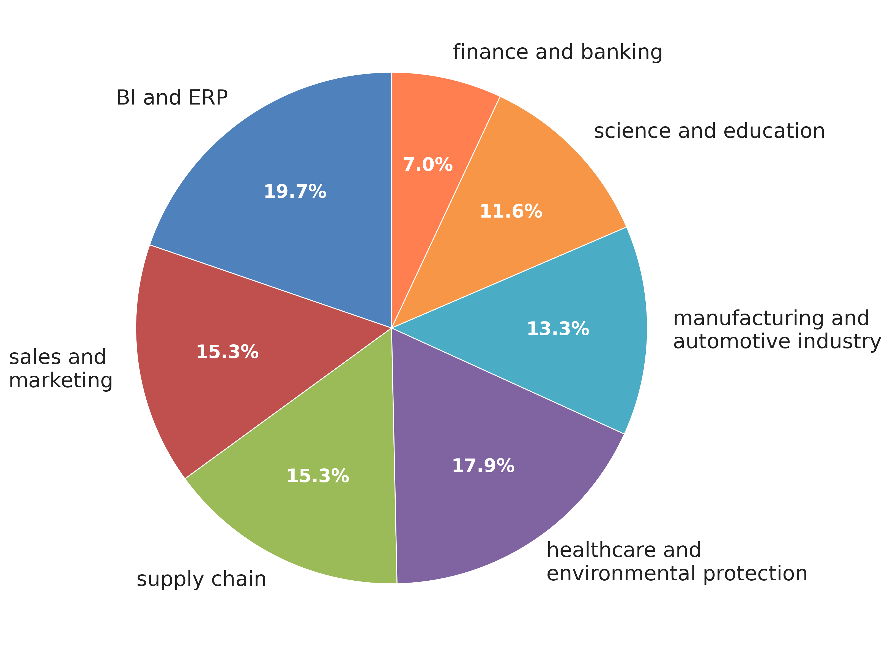
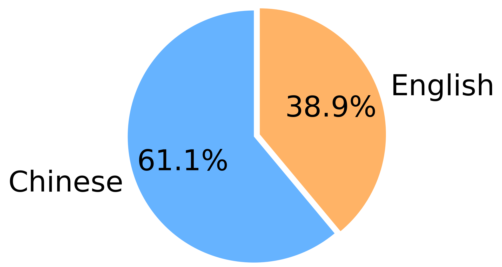
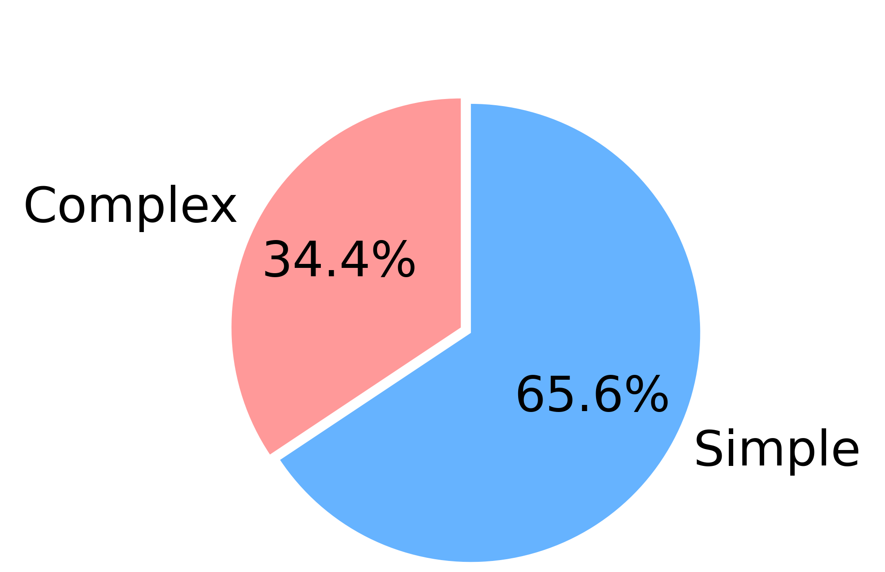
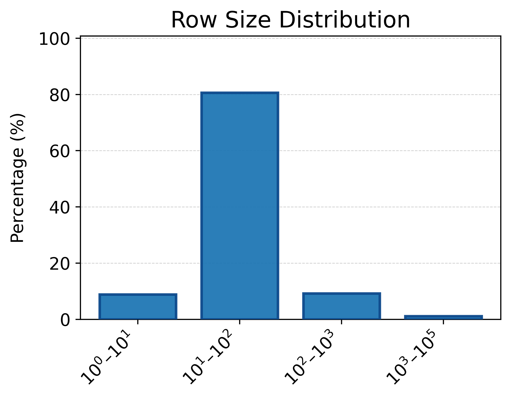
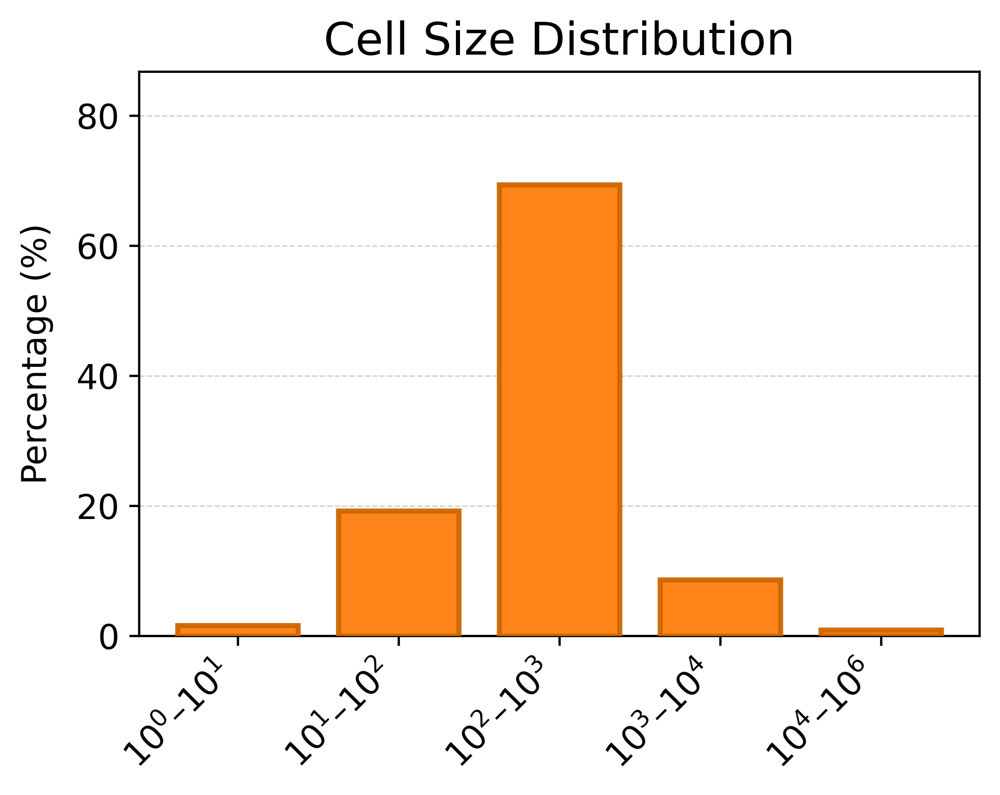
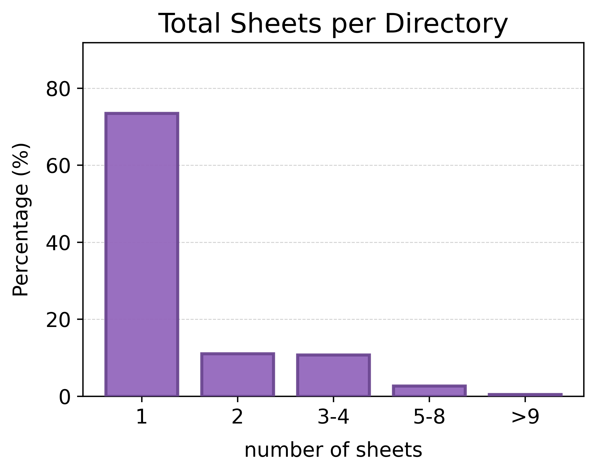
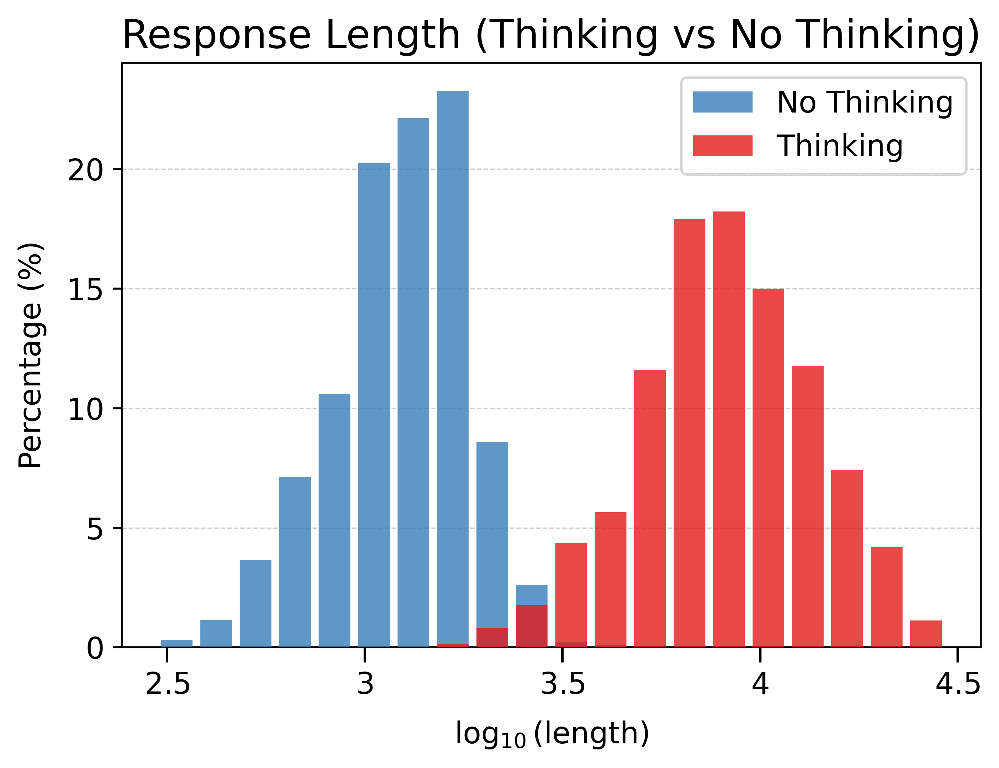

# B.13. Details of Data Statistics

[Appendix contents](../../README.md) · [Appendix B contents](README.md)

**Structural Complexity**
Table 3 and Figure [7](#figure-7) present the key statistics and structural distribution. Notably, IR-TabQA is characterized by its high-fidelity industrial complexity: 8.3% are extremely large-scale tables containing over 50K cells, 34.4% feature complex structures such as hierarchical indexing and non-uniform merged cells, and 28.3% are multi-table or multi-sheet configurations.

**Domain and Sub-domain**
Illustrated in Figure [7a](#figure-7a), the benchmark spans seven primary industrial domains, further categorized into 30 specialized sub-domains including marketing, manufacturing, automotive, business intelligence (BI), enterprise resource planning (ERP), and supply chain. Detailed sub-categories are provided in Table [11](#table-11), ensuring the dataset encapsulates the diversity of real-world industrial scenarios.

### Table 11

The 7 domains and 30 sub-domains in IR-TabQA

| Domains | Sub-domains |
| --- | --- |
| Sales and Marketing | Tourism and Hospitality Services; Food and Beverage Services; Digital Marketing and Social Media; Market Research and Consumer Behavior |
| Manufacturing and Automotive industry | Electronics and Automation Manufacturing; Chemical Engineering and Advanced Materials; Energy Production and Power Systems; Automotive Manufacturing and Mobility Solutions; Industrial Machinery and Heavy Equipment |
| BI and ERP | Business Management; Retail Trade and E-commerce Platforms; Enterprise Resource Planning Systems; Customer Relationship Management |
| Supply chain | Telecommunications and IT Infrastructure; Transportation Networks and Logistics Management; Procurement and Supplier Relations; Global Trade and Customs Compliance |
| Healthcare and Environmental protection | Healthcare Systems and Public Health; Environmental Protection; Agricultural Production and Forestry Management; Marine Resources and Fisheries Management |
| Science and Education | Education and Scientific Research; STEM Education and Curriculum Development; Academic Research Infrastructure and Laboratory Management; E-Learning and Educational Technology; Language Training and Cultural Exchange |
| Finance and Banking | Economic Development and International Trade; Banking and Financial Services; Investment and Wealth Management; Fintech and Blockchain Technologies |

### Figure 7

Distribution of different types of tables in IR-TabQA.  (a) Domain distribution. (b) Proportion of Chinese and English tables. (c) Proportion of complex header tables. (d-e) The row and cell size distribution for all tables. (f) Proportion of sheets number in each directory. (g) Distribution of response length for SFT datasets with different reasoning modes.

#### Figure 7a

#### Figure 7b

#### Figure 7c

#### Figure 7d

#### Figure 7e

#### Figure 7f

#### Figure 7g

