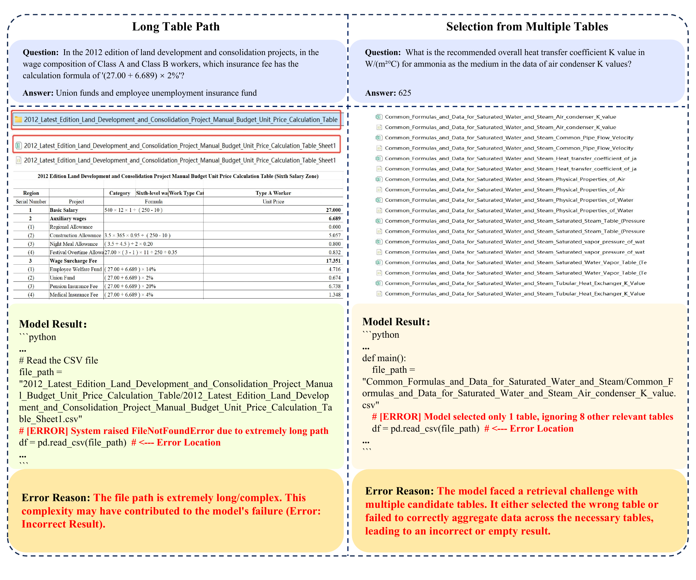
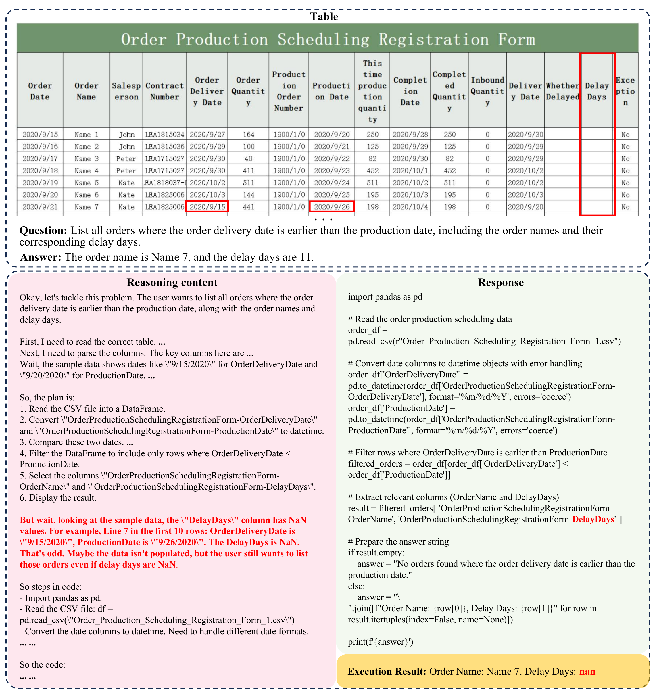
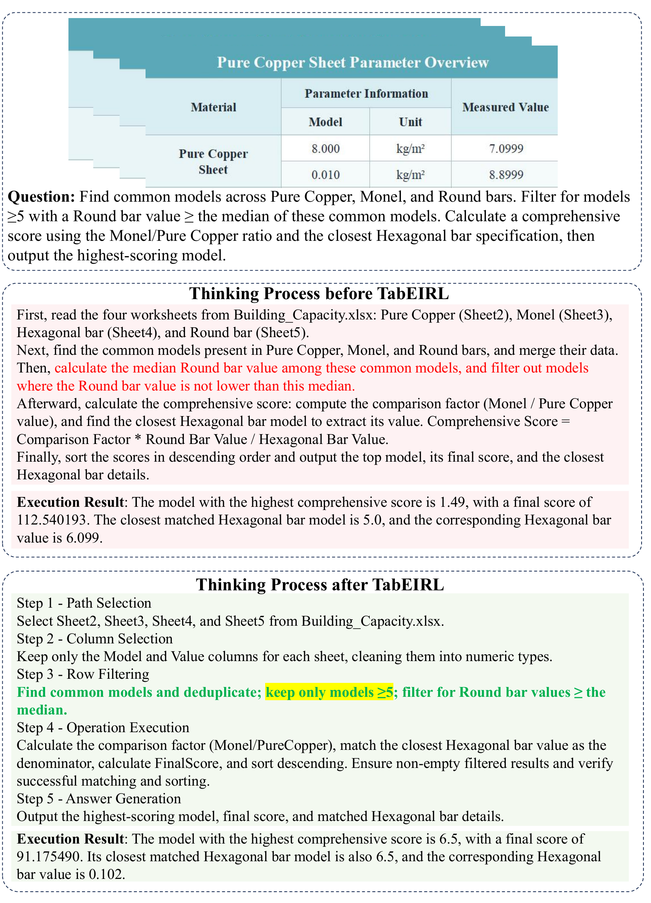

# C.5. Analysis of Detailed Case Study

[Appendix contents](../../README.md) · [Appendix C contents](README.md)

Our analysis of the top-performing model (GPT-5.4) reveals a critical limitation in its reasoning capability and code generation.
When handling long file names or scenarios involving multiple tables, the model occasionally produces code with incorrect or incomplete file paths, leading to execution failures, as shown in Figure [8](#figure-8). According to statistical analysis, file path-related issues account for approximately 24.29% of the identified bad cases.

In another case shown in Figure [9](#figure-9), although the model’s reasoning process correctly identified missing values in the "Delay Days" column, it failed to utilize relevant available columns (e.g., Order Delivery Date and Delivery Date) to computationally derive the Delay Days metric. This logical gap resulted in null (NaN) outputs during code execution, despite the presence of sufficient data to support the inference.

As shown in the Figure [10](#figure-10), the model trained with TabEIRL generates more robust and higher-quality reasoning process. Specifically, the enhanced model demonstrates improved capability in detecting ill-formatted or anomalous cells (e.g., "8.3J%" in numerical column) within tabular data and employs defensive programming techniques (e.g., try-except blocks, errors='coerce' in pandas operations) to prevent runtime failures. This results in more resilient code execution, particularly when handling noisy or inconsistent real-world industrial datasets.

### Figure 8

An example illustrating erroneous file path generation even by the best method GPT-5.4 in scenarios involving long table path or multiple tables, leading to execution failure

### Figure 9

An example illustrating an original table and its corresponding report generated even by the best method GPT-5.4, with critical error highlighting.

### Figure 10

Comparison of reasoning process and code execution results before and after TabEIRL on the same case

